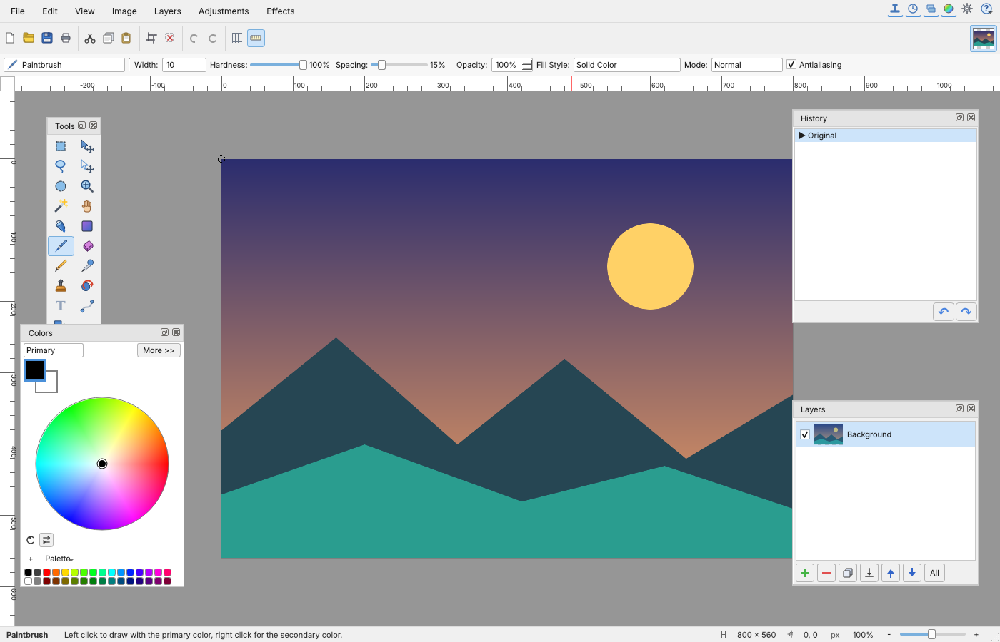

# Paint.with.me

A free, open-source raster image editor for Linux with the familiar look and
workflow of Paint.NET: layers, blend modes, selections, adjustments and effects,
built natively in C++17 and Qt 6. No Wine, no .NET runtime.

<p align="center">
  <a href="https://github.com/Shelin-boop/Paint.with.me/releases/download/continuous/Paint.with.me-x86_64.AppImage"></a>
</p>
<p align="center">
  <a href="https://github.com/Shelin-boop/Paint.with.me/releases/download/continuous/paint-with-me_amd64.deb"></a>
  <a href="https://github.com/Shelin-boop/Paint.with.me/releases/download/continuous/paint-with-me-fedora.x86_64.rpm"></a>
  <a href="https://github.com/Shelin-boop/Paint.with.me/releases/download/continuous/paint-with-me-opensuse.x86_64.rpm"></a>
  <a href="https://github.com/Shelin-boop/Paint.with.me/releases/download/continuous/paint-with-me-arch-x86_64.pkg.tar.zst"></a>
</p>
<p align="center"><sub>Free, for 64-bit Linux. Always the newest build. Which one to pick and how to
install it: <a href="#install">Install</a>. All files and checksums:
<a href="https://github.com/Shelin-boop/Paint.with.me/releases">Releases</a>.</sub></p>



> **Status: early development.** Paint.with.me is a fork of
> [paint.software](https://github.com/Univers4craft/paint.software) by
> Univers4craft, taken at upstream commit `db9691f` (2026-10-31). See
> [FORK.md](FORK.md) for what has changed since.

## Goals

- Look and feel close to Paint.NET, on Linux.
- Open Paint.NET `.pdn` files with their layers.
- Keep layered work in common formats only, no format of its own.
- A portable AppImage that adds itself to the start menu, and installers for
  Debian, Ubuntu, Linux Mint, Fedora, openSUSE and Arch Linux.
- New tools Paint.NET does not have: a smudge tool and a blur brush.
- Text in frames that stays editable until you turn it into pixels.
- Sizes in millimeters, centimeters or inches at a chosen resolution.
- Turn the view like a sheet of paper, and choose your own keyboard shortcuts.
- Several images in one window; move an image to another window by dragging
  its thumbnail.

## Install

Use the buttons at the top, or pick the file here. All of them are for 64-bit
PCs (x86-64) and always the newest build.

| Your system | Download | |
|---|---|---|
| Any 64-bit Linux, also older ones such as Ubuntu 22.04 or Linux Mint 21 | [Paint.with.me-x86_64.AppImage](https://github.com/Shelin-boop/Paint.with.me/releases/download/continuous/Paint.with.me-x86_64.AppImage) | needs no installation |
| Ubuntu 24.04 or newer, Kubuntu, Linux Mint 22 or newer, Debian 12 or newer | [paint-with-me_amd64.deb](https://github.com/Shelin-boop/Paint.with.me/releases/download/continuous/paint-with-me_amd64.deb) | installer |
| Fedora (the two newest releases) | [paint-with-me-fedora.x86_64.rpm](https://github.com/Shelin-boop/Paint.with.me/releases/download/continuous/paint-with-me-fedora.x86_64.rpm) | installer |
| openSUSE Leap 16 or newer, openSUSE Tumbleweed | [paint-with-me-opensuse.x86_64.rpm](https://github.com/Shelin-boop/Paint.with.me/releases/download/continuous/paint-with-me-opensuse.x86_64.rpm) | installer |
| Arch Linux, EndeavourOS | [paint-with-me-arch-x86_64.pkg.tar.zst](https://github.com/Shelin-boop/Paint.with.me/releases/download/continuous/paint-with-me-arch-x86_64.pkg.tar.zst) | installer |

**AppImage or installer?** The AppImage is one file that brings everything it
needs and runs without being installed. The installers put the program into
your system like any other program and use the system's own Qt; on KDE Plasma
they also take on the desktop's look. Both work the same otherwise.

### AppImage (any distribution)

1. Download `Paint.with.me-x86_64.AppImage`.
2. Make it executable: right-click it, Properties, Permissions, "Is executable",
   or run `chmod +x Paint.with.me-x86_64.AppImage`.
3. Start it. On the first start it adds itself to your application menu.
   **Help > Remove from application menu** takes it out again.

Moving the file or replacing it with a newer version is fine: the menu entry is
updated the next time you start it from its new place. It needs glibc 2.35 or
newer (Ubuntu 22.04 and every distribution of 2022 or later); no other
installation is needed, not even libfuse2.

### Installers

Open the downloaded file with your software installer (Discover on KDE,
Software on GNOME; often a double-click does it), or run the command in a
terminal in the folder where the file is:

| System | Install | Remove |
|---|---|---|
| Ubuntu, Kubuntu, Linux Mint, Debian | `sudo apt install ./paint-with-me_amd64.deb` | `sudo apt remove paint-with-me` |
| Fedora | `sudo dnf install ./paint-with-me-fedora.x86_64.rpm` | `sudo dnf remove paint-with-me` |
| openSUSE | `sudo zypper install --allow-unsigned-rpm ./paint-with-me-opensuse.x86_64.rpm` | `sudo zypper remove paint-with-me` |
| Arch Linux, EndeavourOS | `sudo pacman -U ./paint-with-me-arch-x86_64.pkg.tar.zst` | `sudo pacman -R paint-with-me` |

The package manager also installs what the program needs from your system
(Qt and its plugins). The program then appears in the application menu.

**Updates** do not arrive by themselves yet: download the newer file and
install it the same way; your settings stay. Help > About shows the version
you have.

Ubuntu 22.04 and Linux Mint 21 have a Qt that is too old for the `.deb`, so
it does not install there; use the AppImage instead.

Checksums of all files are in `SHA256SUMS` on the
[Releases](https://github.com/Shelin-boop/Paint.with.me/releases) page:
`sha256sum -c --ignore-missing SHA256SUMS`.

## Using it

On a Wayland desktop (KDE Plasma, GNOME) it runs natively on Wayland. If that
causes trouble, choose **XWayland** in Settings > User Interface; it offers to
restart right away. Help > About shows which one is in use.

The canvas is drawn by the graphics card (OpenGL) when it has a suitable
driver, and by the processor otherwise. Settings > Canvas > Drawing the Image
shows which one is in use and lets you choose; `paint-with-me --no-gpu` starts
once without the graphics card. If the program closes unexpectedly while
starting the graphics card, the next start uses the processor and says so.

Graphics tablets: pressing harder can change the brush size, its opacity or
both (the **Pressure** list in the tool bar, shown once a pen has been used).
Settings > Tools has a pressure curve, an option for pen tilt and a pad to
try your pen.

The panels sit at the sides of the main window: Tools above Colors on the left,
History above Layers on the right. Drag a panel by its title to another side or
onto another panel (to make tabs), drag the gaps between panels to resize them,
or double-click a title to make the panel float. F5 to F8 show and hide them;
**View > Reset Panel Layout** puts everything back.

The Tools panel grows a third and a fourth column when it is wide enough. Put
your own shortcuts there with the **+** button or a right-click: any menu
command (an adjustment, an effect, an image or layer command) or the current
brush saved as a preset (tool, width, hardness, opacity ...). Drag a shortcut
to move it; right-click it to remove it, or to rename or update a preset.
Right-click > Columns fixes the number of columns.

**Perspective tool** (V, next to Shapes): click on the image to place up to
three vanishing points (they may also lie outside the image), drag them to
move, right-click to remove. Guide lines radiate from them over the canvas.
Strokes of the paintbrush, pencil, eraser, line, clone stamp and recolor tools
then follow the guide they start along; the tool options set the number of
lines, snapping to horizontal and vertical, and "Guides to New Layer" draws
the lines into a layer of their own. View > Perspective Guides and Snap to
Perspective switch them on and off while you paint.

**Several images** open side by side in one window, shown as thumbnails at the
top (the x on a thumbnail closes that image; a middle-click does too). Images
opened from the file manager or the application menu are added to the window
used last, so you can switch between them and copy from one into another.
Drag a thumbnail along the row to reorder, or into another Paint.with.me
window to move the image there with its layers; right-click > Move to New
Window opens it in a window of its own (File > New Window starts an empty one).
Settings > User Interface > "Open images in the window used last" turns the
adding off. With a picture on the clipboard, File > New starts at its size.

**Primary and secondary color**: the left mouse button paints with the color
chosen in the Colors panel (click its swatch, or the list above, or press C),
the right button with the other one.

**Arrow keys** move a selection: one pixel per press, and after three seconds
of holding a key, 1% of the image's width or height per step. With Move
Selection only the outline moves; with every other tool the selected pixels.

**Rotate the view** like a sheet of paper on a desk: View > Rotate View, or
the keys 4 and 6 (5 turns it back). Only the view turns; the image, saving and
printing are not affected. How far one step turns it is chosen in the same
menu (1 to 90 degrees, or any other step) or in Settings > Canvas. Hold
Shift+Space and drag to turn it freely. While it is turned, the status bar
shows the angle; click it to turn back.

**Keyboard shortcuts** can be changed in Settings > Keyboard: every menu
command, every tool, and keys of their own for the last used painting tool
(N), switching to the Eraser and back (Shift+E), the brush width ([ and ]),
panning while a key is held (Space), the Color Picker while a key is held (I)
and more. Search by name or by key; a key another command already has is
taken from it after asking. Tools given the same key take turns. Useful for
the express keys of a pen display: let the tablet driver send a key, then give
that key to the command here. Help > Keyboard shortcuts lists the current keys.

**Undo** keeps as many steps as fit into a memory limit (Settings > Undo
History; by default one eighth of the computer's memory, between 512 MB and
2 GB). When the steps need more, the oldest are dropped.

**Pen tablets**: pen pressure changes the brush width, as in Paint.NET. It is
read through Qt's tablet support, so it works wherever the system's tablet
driver delivers pressure (tested by the owner with an XPPen Artist 15.6 Pro V2
on Kubuntu).

## File formats

| Format | Open | Save | Layers |
|---|---|---|---|
| Photoshop `.psd` | yes | yes | kept |
| Photoshop large document `.psb` | yes | no | kept |
| Paint.NET `.pdn` | yes | no | kept |
| PNG, JPEG, BMP, TIFF, WebP | yes | yes | flattened |
| GIF | yes | no | flattened |
| PDF | pictures in it: File > Extract Picture from PDF... | File > Export as PDF... | one page, or one page per layer |

To keep your layers, save as `.psd`. Krita and GIMP open it with every layer's
name, position, opacity, visibility and blend mode, and the resolution (dpi)
(tested with Krita 5 and GIMP 2.10). The file follows Adobe's published PSD
format, so other programs should read it too; Photoshop itself has not been
tested. Paint.NET's Glow, Negation, Reflect, Xor and Overwrite
blend modes have no Photoshop equivalent; such layers are saved as Normal, and
the app asks before it does that.

Opening a `.psd` made elsewhere: pixel layers come in as they are. Layer groups
are opened as separate layers (with the group's visibility and opacity
applied), layer masks are applied to their layer, 16-bit and CMYK documents
are converted to 8-bit RGB. Adjustment layers, layer styles and vector masks
are not supported yet. After opening, a message lists anything that changed.

Text layers are saved in a `.psd` as their pixels plus a small block of
Paint.with.me's own with the text, so Paint.with.me can edit them again. Other
programs skip that block and show the text layer as an ordinary pixel layer
(checked with GIMP 2.10 and psd-tools).

Saving writes a new file first and replaces the old one only when it is
complete, so a crash or power loss while saving cannot damage it. Autosave
(every minute, in the background) keeps the layers too.

**File > Export as PDF...** writes each page as a picture at the image's
resolution, so the page has the image's print size (for example 7625 x 5250
px at 600 dpi gives a 322.8 x 222.3 mm page). Choose lossless pictures (every
pixel exact) or JPEG, the whole image or one page per layer, and transparency
or a white background.

**File > Extract Picture from PDF...** (or opening or dropping a PDF) lists
the pictures inside a PDF in the order its pages show them, with the first one
chosen. Open it as a new image at the resolution it has on the page, copy it to
the clipboard, or add it as a layer. It reads JPEG and the common lossless
encodings, gray, RGB, CMYK and indexed colors and transparency. It does not
draw whole pages, and it cannot read pictures stored as JPEG 2000, JBIG2 or
CCITT fax, nor protected (encrypted) PDFs.

## Roadmap

1. Rebrand and English-only interface (done)
2. AppImage for Kubuntu and other distributions, with a start-menu entry (done)
3. Speed with large images, panels docked in the main window (done)
4. File formats: layered PSD instead of the inherited `.psw` format (done)
5. A memory-efficient undo history (done)
6. Code cleanup, native Wayland (done)
7. Smudge tool and blur brush (done)
8. Editable text frames, print sizes in mm/cm/in with dpi, pictures from PDFs (done)
9. Rotating the view, keyboard shortcuts of your own (done)
10. Several images and windows: thumbnails with a close button, moving images
    between windows, files opened into the running window; secondary color,
    arrow keys for selections, File > New from the clipboard (done)
11. Faster drawing on images with many layers: layers below and above the one
    being painted are kept combined; the canvas is drawn by the graphics card
    (done)

## Build from source

Requirements: a C++17 compiler, CMake 3.16 or newer, Qt 6.4 or newer
(Widgets, Gui, Core, PrintSupport, Concurrent, Network, OpenGL, OpenGLWidgets)
and zlib.

```bash
# Debian / Ubuntu / Kubuntu / Linux Mint (Debian 12: add libqt6opengl6-dev)
sudo apt install build-essential cmake ninja-build qt6-base-dev \
  qt6-image-formats-plugins libgl1-mesa-dev zlib1g-dev

cmake -B build -G Ninja -DCMAKE_BUILD_TYPE=Release
cmake --build build
./build/paint-with-me
```

Run the headless test suite:

```bash
cmake --build build --target pwm_all_tests
QT_QPA_PLATFORM=offscreen ctest --test-dir build --output-on-failure
```

The offscreen run has no OpenGL, so the graphics card part of `pwm_gpu_tests`
is skipped there. To run it without a graphics card, use Mesa's software
renderer on a virtual X display (`sudo apt install xvfb libgl1-mesa-dri`):

```bash
xvfb-run -a env QT_QPA_PLATFORM=xcb PWM_REQUIRE_GPU=1 ./build/pwm_gpu_tests
```

The installers are built inside a container of each system, after all test
suites have passed there (Docker or Podman; the comment at the top of each
script names the system to use):

```bash
docker run --rm -v "$PWD:/src" -w /src debian:12 packaging/build-deb.sh 0.1.0 dist
docker run --rm -v "$PWD:/src" -w /src fedora:43 packaging/build-rpm.sh 0.1.0 dist
docker run --rm -v "$PWD:/src" -w /src opensuse/leap:16.0 packaging/build-rpm.sh 0.1.0 dist
docker run --rm -v "$PWD:/src" -w /src archlinux:latest packaging/build-arch.sh 0.1.0 dist
docker run --rm -v "$PWD:/src" -w /src ubuntu:24.04 \
  packaging/test-installed-package.sh dist/paint-with-me_amd64.deb
```


## Credits

Almost all of the code comes from
[paint.software](https://github.com/Univers4craft/paint.software) by
Univers4craft and its contributors, under the MIT license. The `.pdn` test files
in `tests/data/pdn` come from [pypdn](https://github.com/addisonElliott/pypdn)
(MIT, see `tests/data/pdn/LICENSE-pypdn`).

## License

MIT, see [LICENSE](LICENSE). The original copyright notice of paint.software is
kept there, as the MIT license requires.

## Disclaimer

Paint.with.me is an independent community project. It is not affiliated with,
endorsed by, or sponsored by dotPDN LLC or Rick Brewster, the makers of
Paint.NET, nor by Univers4craft, the maintainer of paint.software. "Paint.NET"
is named only to describe the software this project is modeled on and
compatible with.
