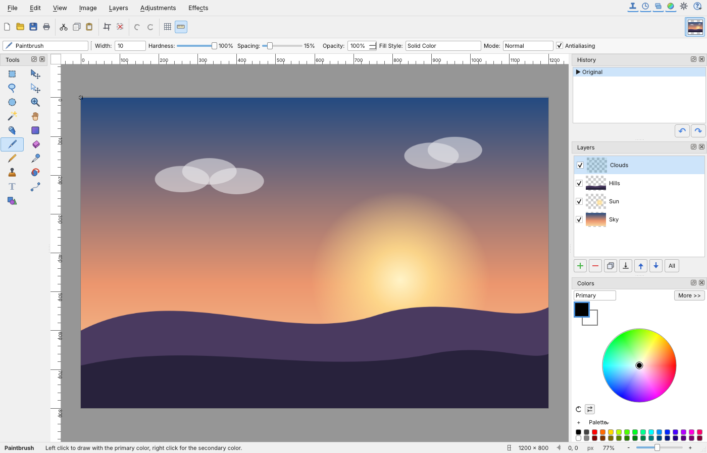

# Paint.with.me

A free, open-source raster image editor for Linux with the familiar look and
workflow of Paint.NET: layers, blend modes, selections, adjustments and effects,
built natively in C++17 and Qt 6. No Wine, no .NET runtime.



> **Status: early development.** Paint.with.me is a fork of
> [paint.software](https://github.com/Univers4craft/paint.software) by
> Univers4craft, taken at upstream commit `db9691f` (2026-10-31). See
> [FORK.md](FORK.md) for what has changed since.

## Goals

- Look and feel close to Paint.NET, on Linux.
- Open Paint.NET `.pdn` files with their layers.
- Keep layered work in common formats only, no format of its own.
- A portable AppImage that adds itself to the start menu.
- New tools Paint.NET does not have: a smudge tool and a blur brush.

## Install

1. Download the newest `Paint.with.me-*-x86_64.AppImage` from the
   [Releases](https://github.com/Shelin-boop/Paint.with.me/releases) page
   ("Latest build" is always the most recent one).
2. Make it executable: right-click it, Properties, Permissions, "Is executable",
   or run `chmod +x Paint.with.me-*-x86_64.AppImage`.
3. Start it. On the first start it adds itself to your application menu.
   **Help > Remove from application menu** takes it out again.

Moving the file or replacing it with a newer version is fine: the menu entry is
updated the next time you start it from its new place.

It needs a 64-bit Linux, such as Ubuntu or Kubuntu 22.04 or newer; the release
notes name the exact glibc version. No other installation is needed, not even
libfuse2.

On a Wayland desktop (KDE Plasma, GNOME) it currently runs through XWayland.
To try native Wayland anyway, start it with `QT_QPA_PLATFORM=wayland`.

The Tools, History, Layers and Colors panels sit at the sides of the main
window. Drag a panel by its title to another side or onto another panel (to
make tabs), drag the gaps between panels to resize them, or double-click a
title to make the panel float. F5 to F8 show and hide them; **View > Reset Panel
Layout** puts everything back.

## Roadmap

1. Rebrand and English-only interface (done)
2. AppImage for Kubuntu and other distributions, with a start-menu entry (done)
3. Speed with large images, panels docked in the main window (done)
4. File formats: layered PSD instead of the inherited `.psw` format
5. A memory-efficient undo history
6. Code cleanup, native Wayland
7. Smudge tool and blur brush

## Build from source

Requirements: a C++17 compiler, CMake 3.16 or newer, Qt 6.4 or newer
(Widgets, Gui, Core, PrintSupport, Concurrent) and zlib.

```bash
# Debian / Ubuntu / Kubuntu / Linux Mint
sudo apt install build-essential cmake ninja-build qt6-base-dev \
  qt6-image-formats-plugins libgl1-mesa-dev zlib1g-dev

cmake -B build -G Ninja -DCMAKE_BUILD_TYPE=Release
cmake --build build
./build/paint-with-me
```

Run the headless test suite:

```bash
cmake --build build --target pwm_tests pwm_brush_tests \
  pwm_paste_tests pwm_preview_tests pwm_integration_tests
QT_QPA_PLATFORM=offscreen ctest --test-dir build --output-on-failure
```


## Credits

Almost all of the code comes from
[paint.software](https://github.com/Univers4craft/paint.software) by
Univers4craft and its contributors, under the MIT license. The `.pdn` test files
in `tests/data/pdn` come from [pypdn](https://github.com/addisonElliott/pypdn)
(MIT, see `tests/data/pdn/LICENSE-pypdn`).

## License

MIT, see [LICENSE](LICENSE). The original copyright notice of paint.software is
kept there, as the MIT license requires.

## Disclaimer

Paint.with.me is an independent community project. It is not affiliated with,
endorsed by, or sponsored by dotPDN LLC or Rick Brewster, the makers of
Paint.NET, nor by Univers4craft, the maintainer of paint.software. "Paint.NET"
is named only to describe the software this project is modeled on and
compatible with.
